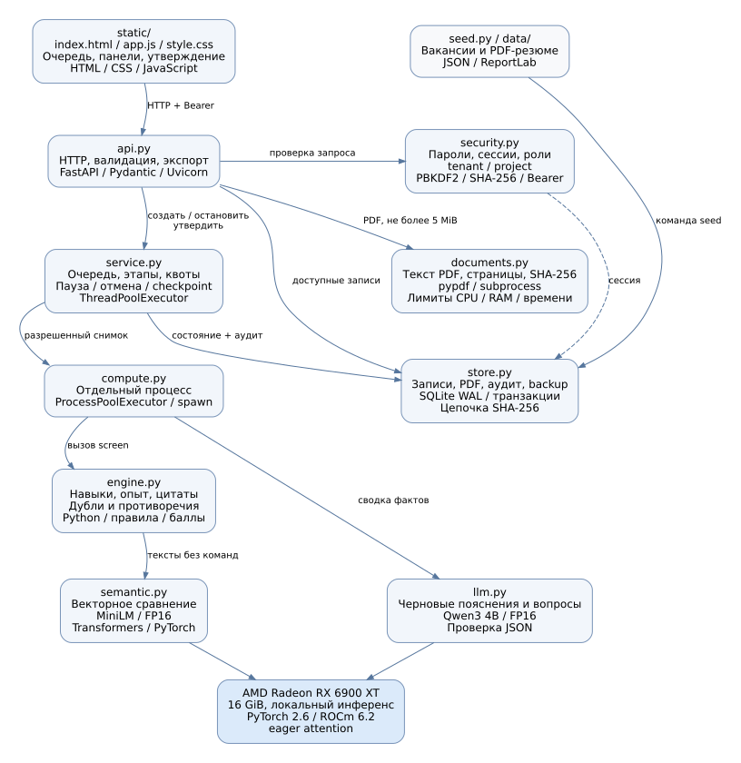

# HR-скрининг

Локальный сервис сопоставляет резюме с вакансией, собирает короткий список с цитатами и вопросами для интервью. Результат проверяет и утверждает рекрутер

## Запуск

Проверено на Linux, Python 3.12 и AMD Radeon RX 6900 XT 16 GiB с PyTorch 2.6.0+rocm6.2.4. Драйвер ROCm и доступ к `/dev/kfd` и `/dev/dri` должны работать до запуска

```bash
python3 -m venv --system-site-packages .venv
source .venv/bin/activate
pip install -r requirements.txt
python scripts/download_models.py
python -m hr_screening.seed --pdf
set -a
source .env.example
set +a
python -m hr_screening
```

Если PyTorch еще не установлен: `pip install torch==2.6.0 --index-url https://download.pytorch.org/whl/rocm6.2.4`

Открыть [127.0.0.1:8000](http://127.0.0.1:8000), описание API находится на `/docs`. Без `HR_MODEL_PATH` и `HR_LLM_PATH` работает базовое сопоставление по словарю и правилам. Веса скачиваются отдельной командой и закреплены версиями, при обработке используется локальный кеш

## Демонстрационный доступ

Команда seed создает синтетические записи и учетные записи

| Логин | Пароль | Доступ |
|---|---|---|
| recruiter | Recruiter-2026! | Вакансии, резюме, задания |
| client | Client-2026! | Утвержденные карточки |
| admin | Admin-2026! | Метрики, остановка, аудит |
| auditor | Auditor-2026! | Аудит |

## Проверки

```bash
pytest -q
node --test tests/ui_session.test.cjs
python scripts/experiment_pdf.py
python scripts/experiment.py --mode baseline --repeats 5
HR_DEVICE=cuda HF_HUB_OFFLINE=1 python scripts/experiment.py --mode semantic --repeats 5
python scripts/load_test.py
python scripts/verify_controls.py
HR_DEVICE=cuda HF_HUB_OFFLINE=1 python scripts/experiment_llm.py
```

При запущенном приложении `python scripts/verify_gpu_api.py --pdf` проверяет обработку через HTTP и обе модели на GPU. Протоколы лежат в [evidence](evidence), условия замеров в [измерениях](docs/measurements.md). Время зависит от машины, повторный запуск обновляет протоколы

## Тестовые PDF

В [data/resumes](data/resumes) лежат 32 вымышленных резюме. [Manifest](data/resumes/manifest.json) содержит ID, SHA-256 и число страниц. Для воспроизводимой пересборки нужны DejaVu Sans и зависимости отчета

```bash
pip install -r requirements-report.txt
python scripts/build_resumes.py
```

Импорт принимает PDF с текстовым слоем: до 5 MiB, 20 страниц и 30000 символов. Сканы требуют OCR, которого здесь нет. Цитаты открывают сохраненный снимок резюме, оригинал PDF доступен рекрутеру своего проекта

## Документация



[PDF-отчет](output/report.pdf) · [Презентация](output/defense.pptx) · [ТЗ и покрытие](docs/requirements.md) · [Испытания](docs/acceptance.md) · [Эксплуатация](docs/operations.md) · [Паспорт заказчика](docs/customer.md) · [Текст защиты](docs/defense.md)

PDF пересобирается командой `python scripts/build_report.py`, нужны Graphviz, DejaVu Sans и `requirements-report.txt`

MiniLM сравнивает тексты, Qwen3 4B составляет черновые вопросы. Навыки, цитаты и баллы проверяются отдельно от генерации. Пилот работает на одной машине; промышленный вариант и ограничения описаны в отчете
